# 钱多多 · 门店 AI 智能助手

**接上门店的系统和设备，让 AI 帮你看店、算账、出报表。**

Aidol 创造营黑客松 **AI 设备联动赛道**参赛项目。钱多多把收银数据、摄像头、浏览器和门店手机连接到同一个 AI 工作台：店长用自然语言提出目标，助手调用工具取数、理解画面、生成经营页面，并把重复流程保存为技能和定时任务。

这个仓库包含实际的工作台、Agent 网关、MCP 连接器、Android 投屏 App、Rust 设备操作台和 ESP32-C3 控制固件。可以先启动纯软件工作台，再按需要接入真实门店系统与硬件。

[参赛交付材料](#参赛交付材料) · [产品开发说明书](docs/product-development.md) · [设备实物](#设备实物与复现清单) · [快速部署](#快速部署) · [图解硬件安装](#手机与硬件接入) · [完整部署指南](docs/deployment.md)


## 为什么做钱多多

门店已经有收银系统、监控和各种手机 App，但一次经营判断仍需要店长在多个系统之间来回切换：查交易、看现场、核对库存，再手工整理成报表。系统各自有数据，重复工作仍靠人衔接。

我们希望复用门店现有设备与应用，把这些能力变成 AI 可以组合调用的工具，让店长直接说出要完成的事。

| 店长要做的事 | 钱多多的处理方式 |
| --- | --- |
| “帮我看看昨天生意怎么样。” | 查询已接入的收银数据，按时间和可用指标汇总，解释数据来源与统计范围 |
| “看看这几个摄像头，现场有什么需要关注的？” | 获取授权画面，交给支持视觉的模型分析，保留继续追问与取图的能力 |
| “把这些数据做成一个我每天能看的页面。” | 生成可交互的经营页面，通过同一网关调用已授权的数据工具 |
| “以后每天早上做一遍，发到飞书。” | 保存流程、创建定时任务，保留独立执行记录并按连接器配置推送 |
| “这个 App 没有接口，帮我在门店手机上操作。” | 通过配套投屏 App 观察界面，由 AI Passport 发送蓝牙鼠标、键盘输入 |

库存、损耗、ERP 等分析需要相应的业务附件或自定义数据源。新部署不会自动填入模拟门店数据。

## 项目特点

- **一套工作台连接多种能力**：对话、任务页面、技能、定时任务、连接器和执行记录放在一起。
- **两条接入路径**：有可用数据能力的系统通过 MCP 接入；需要界面操作的手机应用通过投屏与蓝牙 HID 接入。
- **按需生成经营工具**：生成的页面无需另写业务后端或 SQL，复用网关、共享计算引擎和已授权工具。
- **从一次任务变成重复流程**：先对齐对象、时间与口径，再把确认过的做法保存为技能或日程。
- **软件与硬件可分开部署**：查看工作台不需要编译固件；需要手机操作时再部署 App、设备操作台和控制板。

## 参赛交付材料

评委可以先阅读[产品开发说明书](docs/product-development.md)，再按下方七步启动软件，按需复现设备联动。说明书按赛事第 7.5 节整理了概述、元器件、端云架构、接线与结构、代码、安全、限制、视频与过程照片，并包含设备协议和联动前后对比。

| 材料 | 当前入口 / 状态 |
| --- | --- |
| 软件与固件源码 | 本仓库；构建环境和命令见[部署指南](docs/deployment.md) |
| 产品开发说明书 | [docs/product-development.md](docs/product-development.md) |
| 设备清单、接入协议、改造前后对比 | 已列入说明书；实际数量、赛前已有、部分来源与结构改造情况待团队确认 |
| 产品介绍视频 | [product-demo.mp4](docs/assets/hackathon/product-demo.mp4)；目前按产品介绍素材标注 |
| 完整实机联动视频 | 待补充最终演示版本及关键片段时间点 |
| 实物 / 过程照片 | 三张设备照片见下方；各关卡过程照片与结果待补充 |

## 设备实物与复现清单

以下三张是本次参赛原型的实物照片。电脑运行工作台和设备操作台；控制板负责蓝牙输入，手机负责运行目标 App 和投屏，摄像头负责提供门店现场画面。

### FoloToy AI Passport：手机键鼠控制板

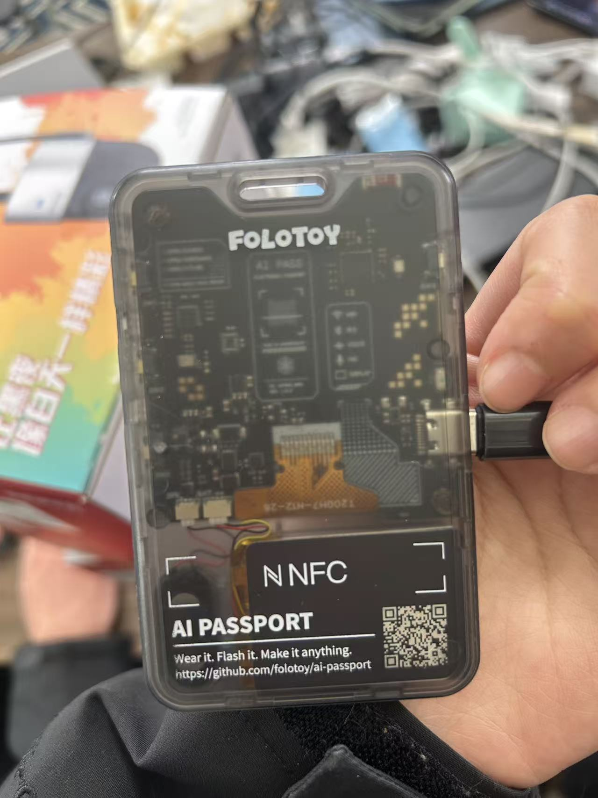

采用 ESP32-C3、8 MB Flash、无 PSRAM。控制板通过 Wi-Fi 或 USB 接收电脑指令，再通过蓝牙 HID 向手机发送鼠标与键盘输入；板上提供 Wi-Fi 配置、安装引导和按键输入锁定。板上“急停”释放并锁定输入，不切断供电。

### OnePlus 8：运行目标 App 与设备投屏

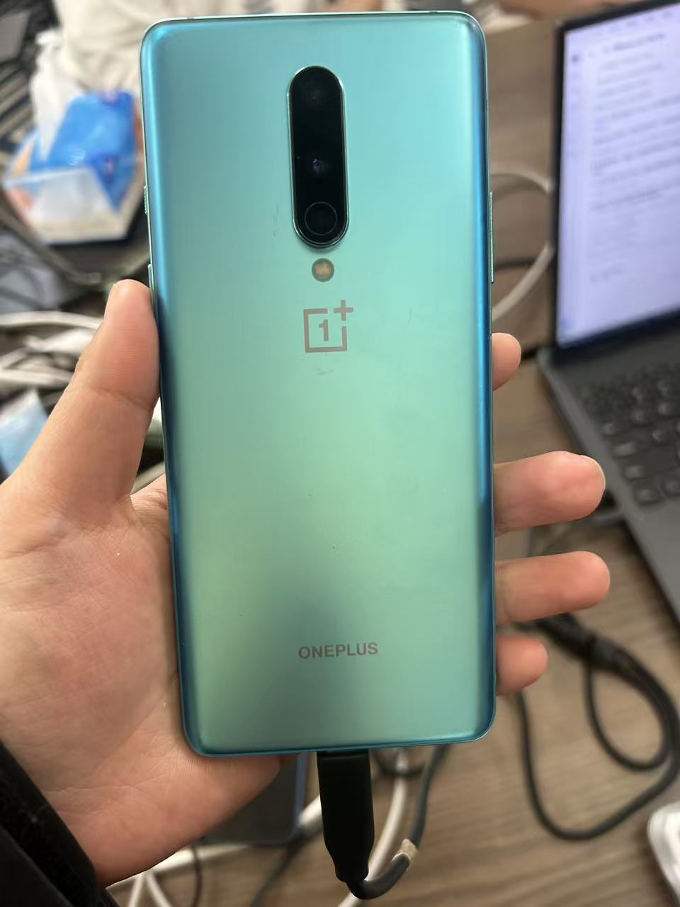

参赛原型使用 OnePlus 8 / Android 13。手机安装本仓库的「设备投屏」App，将画面通过局域网传回电脑，并与 AI Passport 配对。App 支持 Android 8+，其他机型需自行验证配对、投屏和指针校准。

### 海康摄像头：获取门店现场画面

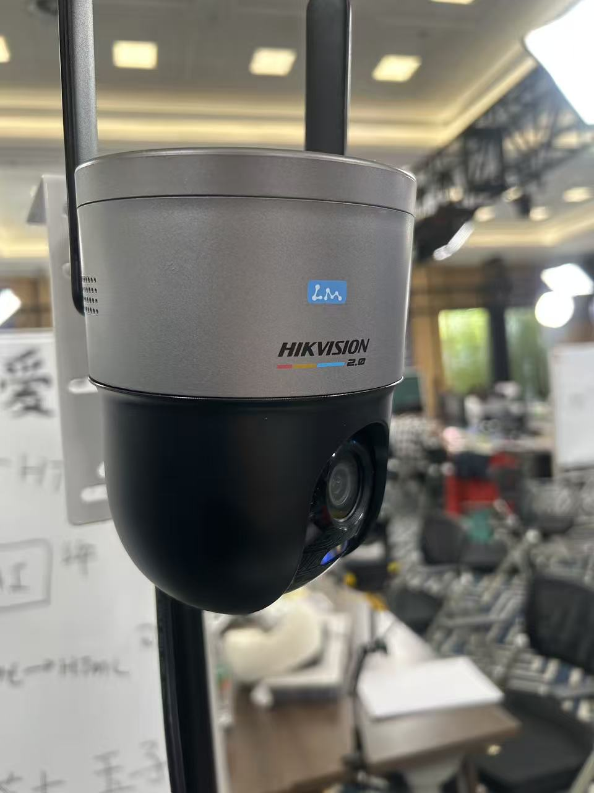

场内设备为海康 HK-Q3S4LW-GL/L，通过 20 AI DOL 币兑换获得。摄像头通过对应平台连接器提供授权画面，与手机控制链路分别接入工作台。

| 准备项 | 本次原型 / 环境要求 | 用途 |
| --- | --- | --- |
| Windows 电脑 | Windows 10 / 11；设备操作台交付程序为 Windows x64 | 运行工作台、网关、本地连接器和设备操作台 |
| AI Passport | FoloToy AI Passport，ESP32-C3、8 MB Flash | 复现手机蓝牙键鼠控制；其他开发板不能直接使用此固件 |
| Android 手机 | 参赛使用 OnePlus 8 / Android 13，需蓝牙与 Wi-Fi | 安装投屏 App、运行被操作的应用 |
| 摄像头与平台账号 | 使用已适配平台且当前账号有权访问的设备 | 复现取图和视觉分析；纯软件与手机演示可分别进行 |
| USB 数据线 | 控制板供电与首次烧录需要；USB 控制时保持连接电脑 | 固件写入、供电和可选 USB 通信 |
| 局域网 | 控制板使用 2.4 GHz Wi-Fi；电脑、手机与控制板相互可达 | 安装包下载、设备发现、手机投屏；关闭 AP 客户端隔离 |
| 互联网与模型 Key | 可访问 npm、工具链下载源、模型服务及所用厂商平台 | 首次安装依赖、模型推理和云端数据接入 |

## 评委复现路线

建议依次完成下表中的阶段。软件工作台可先复现，再根据手头设备增加真实数据与手机操作。

| 阶段 | 需要准备 | 按哪里操作 | 成功标志 |
| --- | --- | --- | --- |
| 1. 启动软件 | Windows 电脑、Git、Node/npm、自己的模型 Key | 下方[快速部署](#快速部署)步骤 1～6 | `/health` 返回 `status: "ok"`，工作台连接成功，对话收到模型回复 |
| 2. 复现经营页面 | 随仓库提供的虚构 CSV 样例 | [无商户账号的复现示例](#步骤7上传样例并生成看板) | 汇总金额与文档给出的参考值一致，任务页能打开并筛选 |
| 3. 接入真实门店 | 自己的商户 / 摄像头账号及权限；视觉分析还需视觉模型 | [接入真实门店系统](#接入真实门店系统) | 控制台登录成功，工具返回自己账号下的实际数据或画面 |
| 4. 复现手机操作 | AI Passport、Android 手机、数据线、局域网 | [手机与硬件接入](#手机与硬件接入)与[完整硬件部署](docs/deployment.md#硬件源码部署) | 操作台出现实时手机画面，点击产生可见响应，急停能停止输入 |

## 产品演示

下面沿着“接入系统 → 提出需求 → 保存技能 → 定时执行”展示参赛素材中的产品流程。界面图片为产品演示片段；实际工具、账号权限和设备状态决定一次任务能完成的范围。

### 连接门店系统，明确授权范围

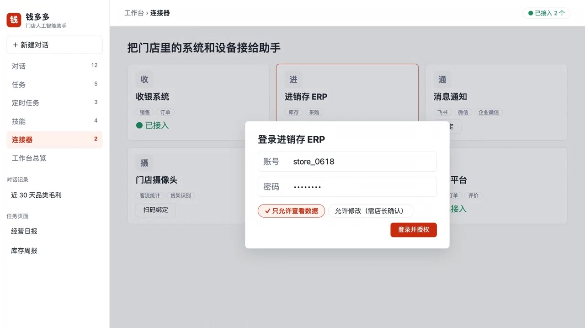

连接器授权交互示意：店长选择业务系统、登录账号并确认访问权限。图中的 ERP 入口展示产品方向；当前内置平台与接入方法见[接入真实门店系统](#接入真实门店系统)。

### 用一句话提出经营问题

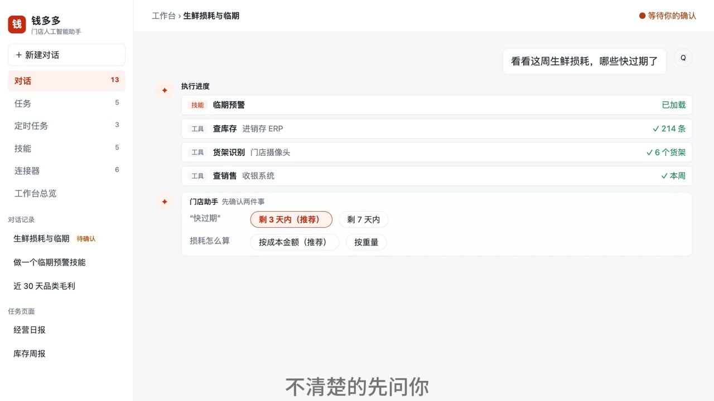

以生鲜损耗与临期分析为例，助手通过对话确认需求、展示取数过程，让店长继续选择要分析的问题。实际部署需先接入相应数据源或上传业务附件。

### 把重复流程保存为技能


参赛视频中的技能流程片段：把确认过的做法加入技能页，后续任务可以复用同一流程。

### 让日常任务按时执行

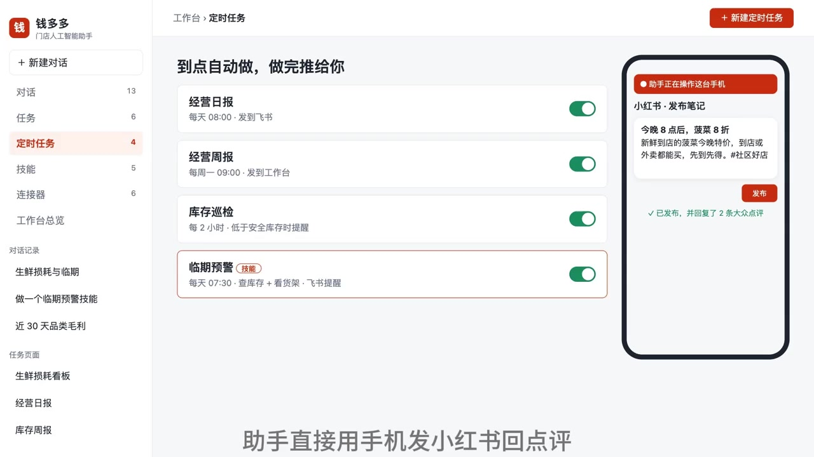

产品演示展示日报、周报、库存巡检等任务，以及手机端的结果交付场景。接入真实业务后，按自己的数据来源、执行时间和交付渠道配置流程。

### 一分钟完整演示

[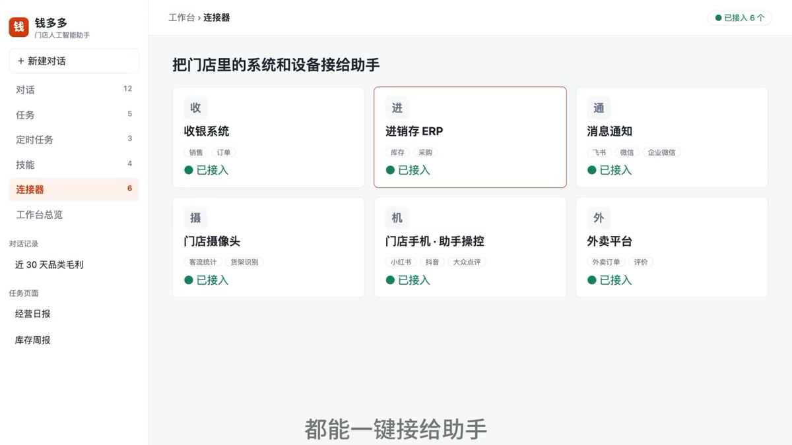](docs/assets/hackathon/product-demo.mp4)

点击封面观看约一分钟的[产品演示视频](docs/assets/hackathon/product-demo.mp4)。封面中的 ERP、外卖等入口展示产品方向。全部图片与视频均保存在仓库的 [参赛素材目录](docs/assets/hackathon/)。

## 系统如何工作

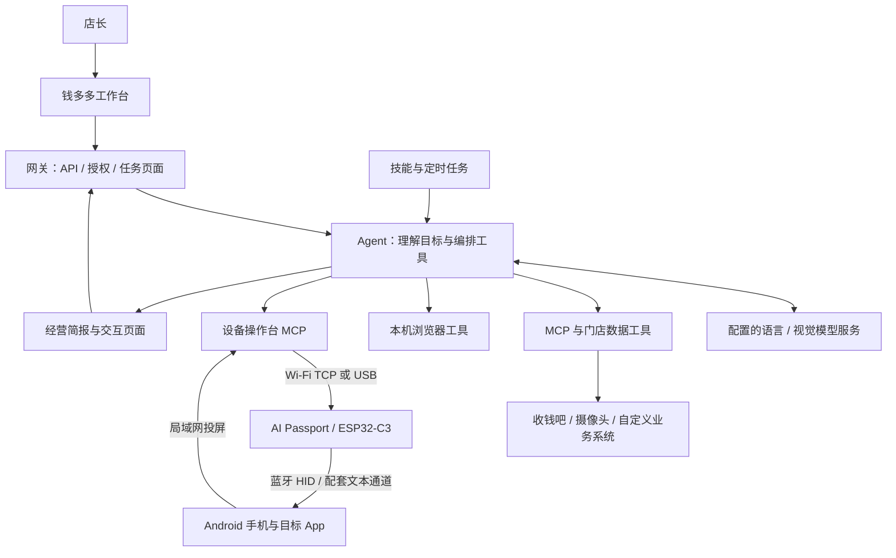

推荐在一台 Windows 电脑上部署工作台、网关和本地连接器，模型通过配置的兼容接口调用。摄像头服务继续访问各厂商平台；手机、电脑和控制板在同一局域网内完成投屏与设备控制。

经营页面通过 `qdd.tool` 直接调用其声明过的数据工具，需要进一步分析时再用 `qdd.ask` 调用 Agent。页面使用独立权限，不能拿到整个工作台的网关 token。具体接口见 [API 文档](docs/api.md)。

### 对话与定时任务的执行边界

- 模型请求使用 `tool_choice: "auto"`；普通会话与定时任务仍需用 `reply` / `finish` 收尾，连续三轮未调用工具会报错并保留对话供切换模型后续聊。页面内 `qdd.ask` 可直接用正文回答。
- 普通会话与定时任务不设固定执行步数上限，旧 `llm.maxSteps` 不再生效；用户取消、错误、重复调用拦截与查询熔断仍保留，页面内 `qdd.ask` 的独立轮数限制不变。
- 助手的建议不代表店长选择或授权；完成、被拒或无法继续时说明实际结果，不擅自追加轮询、改配置或测试推送。运行时收尾提醒使用 `system` 消息，续聊移除旧版误存的固定提醒，保留真实用户发言与工具图片。
- 定时任务只选一种推送路径：每轮摘要用 `notify`，条件推送或自定义正文由 prompt / 技能调用 `send_notification`，两者不同时配置；已有任务改走后者时设 `notify: null`。创建后完成当前请求，不因名称或频率相似擅自替换任务，授权被拒后等待用户新指示。

## 快速部署

**先完成步骤 1～7，就能用随仓库提供的虚构数据演示经营看板。** 这条路线只需 Windows 电脑、模型 Key 和网络；手机、控制板和商户账号可在之后接入。

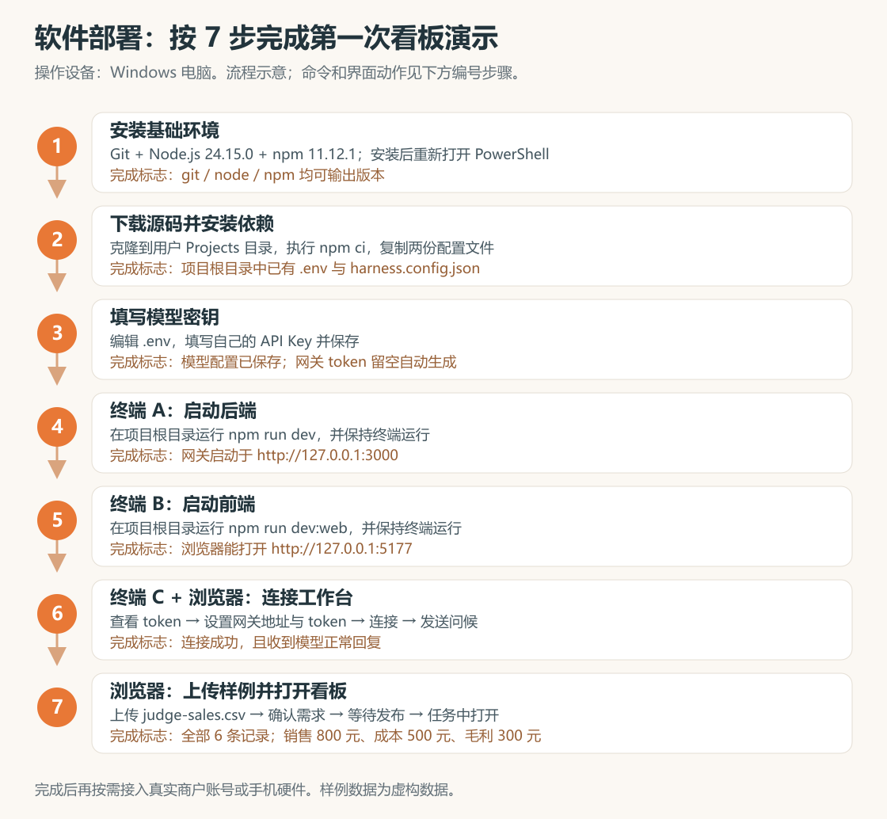

上图为步骤示意，下面给出实际命令和界面操作。命令使用 PowerShell；本节统一把源码放在当前用户的 `Projects/qdd_agent_harness_project` 下。

### 步骤1：安装基础环境

**操作位置：Windows 电脑。**

| 安装项 | 版本 / 安装方法 | 安装完成后检查 |
| --- | --- | --- |
| Git | [Git for Windows](https://git-scm.com/install/windows)，启用命令行 PATH | `git --version` 能输出版本 |
| Node.js | [官方 24.15.0 版本目录](https://nodejs.org/download/release/v24.15.0/)，Windows x64 选择 `node-v24.15.0-x64.msi` | `node --version` 输出 `v24.15.0` |
| npm | Node 安装后，运行下方命令对齐版本 | `npm --version` 输出 `11.12.1` |
| 浏览器 | Chrome / Edge | 能打开本地工作台；Agent 操作浏览器也使用它 |
| 模型 Key | 自己可用的模型 API Key | 留到步骤 3 填写；图片任务还需模型支持图片输入 |

安装 Git 和 Node 后，**重新打开 PowerShell**，执行：

```powershell
npm install --global npm@11.12.1
git --version
node --version
npm --version
```

**完成标志：**三个工具都能输出上述版本。若 PowerShell 拒绝加载 `npm.ps1`，将文中的 `npm` 改写为 `npm.cmd` 即可继续。

### 步骤2：下载源码并安装依赖

**操作位置：电脑 PowerShell。** 首次克隆执行：

```powershell
$qddProjects = Join-Path $env:USERPROFILE "Projects"
New-Item -ItemType Directory -Force $qddProjects | Out-Null
Set-Location $qddProjects
git clone https://github.com/HBAI-Ltd/qdd_agent_harness_project.git
Set-Location qdd_agent_harness_project
npm ci
Copy-Item .env.example .env
Copy-Item harness.config.example.json harness.config.json
```

**完成标志：**`npm ci` 正常结束，当前目录内有 `package.json`、`.env` 和 `harness.config.json`。已有仓库时进入已有目录并保留原配置；以下终端的路径同步改成自己的目录。

### 步骤3：填写模型密钥

**操作位置：电脑、项目根目录。**

```powershell
notepad .env
```

填写并保存：

```dotenv
DEEPSEEK_API_KEY=填写你自己的密钥
HOST=127.0.0.1
PORT=3000
```

`QDD_GATEWAY_TOKEN` 保持为空即可，首次运行会生成。**模型 Key 用于调用模型，网关 token 用于连接工作台，不能互换。** 更换模型服务时按[模型配置](docs/deployment.md#模型配置)修改 `llm.models` 中的模型名、`baseUrl` 和 `apiKeyEnv`。

**完成标志：**已保存自己的有效模型密钥。模型实际可用性将在步骤 6 用对话确认。

### 步骤4：启动后端

**操作位置：新开 PowerShell，作为终端 A。**

```powershell
Set-Location "$env:USERPROFILE/Projects/qdd_agent_harness_project"
npm run dev
```

**完成标志：**构建结束，终端打印网关启动地址 `http://127.0.0.1:3000`。保持终端 A 运行，出现此提示后再做下一步。

### 步骤5：启动前端

**操作位置：再开 PowerShell，作为终端 B。**

```powershell
Set-Location "$env:USERPROFILE/Projects/qdd_agent_harness_project"
npm run dev:web
```

**完成标志：**终端显示前端地址。浏览器打开 **[http://127.0.0.1:5177](http://127.0.0.1:5177)**，能看到工作台。保持终端 B 运行。

### 步骤6：连接工作台并验证模型

**操作位置：终端 C + 电脑浏览器。**

1. 再开 PowerShell，核对后端并查看 token：

```powershell
Set-Location "$env:USERPROFILE/Projects/qdd_agent_harness_project"
Invoke-RestMethod http://127.0.0.1:3000/health
npm run qdd -- token
```

2. 第一条应显示 `status` 为 `ok`。复制第二条输出的 **token 字符串**。
3. 浏览器进入工作台「设置」，填写网关地址 `http://127.0.0.1:3000` 和 token，点击连接。如果保存过旧地址，先点击「使用配置地址」。
4. 回到对话，发送“你好，介绍一下这个工作台能做什么”。

**完成标志：**工作台显示连接成功，且收到模型正常回复。`/health` 成功只说明后端在运行，正常回复才说明模型调用也可用。

| 终端 | 运行内容 | 是否保持运行 |
| --- | --- | --- |
| A | `npm run dev`：后端 / 网关 | 是 |
| B | `npm run dev:web`：工作台前端 | 是 |
| C | 健康核对、查看 token 或后续命令 | 命令完成后可关闭 |

### 步骤7：上传样例并生成看板

**操作位置：电脑浏览器、工作台。无需商户账号或硬件。**

1. 在本地项目找到 [docs/examples/judge-sales.csv](docs/examples/judge-sales.csv)。这是专供评审的虚构销售数据。
2. 新建对话，点击添加文件或把 CSV 拖入输入区。**确认附件卡片已出现、上传结束后**再发送以下请求：

   > 读取这份附件，为 2026-10-17 的虚构销售样例生成经营看板。页面根据附件明细计算销售额、成本额、毛利和毛利率，支持按商品分类筛选，并展示明细和计算口径。标注“虚构样例 / 附件快照，非实时门店数据”。

3. 回答界面上的需求确认问题，等待任务发布。
4. 到「任务」打开新生成的看板，先查看全部分类，再逐个切换商品分类。
5. 按下表核对数值和明细条数，确认筛选确实生效：

| 筛选范围 | 明细条数 | 销售额（元） | 成本额（元） | 毛利（元） | 毛利率 |
| --- | --- | --- | --- | --- | --- |
| 全部 | 6 | 800 | 500 | 300 | 37.5% |
| 生鲜 | 2 | 300 | 210 | 90 | 30% |
| 饮品 | 2 | 200 | 80 | 120 | 60% |
| 日用品 | 2 | 300 | 210 | 90 | 30% |

**完成标志：**看板能实际打开，筛选后明细从 6 条变为对应分类的 2 条，计算结果与表格一致，页面标有虚构样例及数据日期。毛利 = 销售额 − 成本额；毛利率 = 汇总毛利 ÷ 汇总销售额。

需要继续演示技能时，再要求保存刚确认的分析流程，到「技能」查看结果。

| 卡在哪一步 | 先检查什么 |
| --- | --- |
| 工作台连不上后端 | 终端 A 是否运行、网关地址和 token 是否正确；详见[启动问题](docs/deployment.md#6-常见启动问题) |
| 已连接，但模型不回复 | `.env` Key、模型名和服务地址；修改后重启终端 A |
| 没有附件 / 看板数值不一致 | 确认 CSV 上传完成，让助手重新读取这份附件并检查页面计算口径 |

## 接入真实门店系统

**可选：完成上面的样例演示后，再接入自己的商户或摄像头账号。**

1. 在电脑项目根目录安装连接器依赖：

```powershell
npm run mcp:setup
```

2. 上一步成功后编译：

```powershell
npm run mcp:build
```

3. 编译成功后启动本地服务：

```powershell
npm run mcp:start
```

4. 在工作台「连接器」选择平台，点击「验证并安装」。
5. 从连接器卡片打开登录控制台，使用自己的账号完成官方登录。
6. 先确认控制台能返回自己的设备或业务数据，再在对话中请求明确日期范围的查询。摄像头分析还需要支持图片输入的模型。

| 内置平台 | 本地控制台 | 登录前准备 |
| --- | --- | --- |
| 海康互联 | `http://127.0.0.1:8787/` | 自己合法取得的客户端参数，初始化后完成人机验证与短信登录 |
| 收钱吧 | `http://127.0.0.1:8788/` | 商户账号；可网页登录，原生登录另需自己的客户端参数 |
| 天翼视联 | `http://127.0.0.1:8790/` | 使用自己的账号完成官方登录，回填完整返回地址 |
| 萤石 | `http://127.0.0.1:8791/` | 自己的开放平台 AppKey / AppSecret |
| 飞书 | 在工作台配置 | 群机器人 webhook 或企业自建应用配置 |

**完成标志：**服务运行、工作台安装和厂商账号登录分别成功，工具能返回自己账号下的数据。服务启动不会自动登录账号，也不会自动提供模拟门店数据。厂商参数初始化见 [MCP 连接器说明](mcp/README.md)。

### 摄像头录像与播放

对话中的摄像头录像由 `POST /api/chat/videos` 使用网关 Bearer token 读取后，以 blob URL 播放；仅接受已安装且已连接的摄像头来源，不转发凭据或跟随重定向。上限为 256 MiB、120 秒，关闭媒体会取消读取，过期或格式错误会显示原因，接口见 [API 文档](docs/api.md)。

任务页面的 HLS 优先使用同源 hls.js / MSE，在 `MEDIA_ATTACHED` 后加载地址、`MANIFEST_PARSED` 后请求播放，以实际 `playing` 判定播放成功；仅在 hls.js 或 MSE 不可用时回退原生 HLS。天翼本地流已转为 H.264，Chromium 解复用错误不能直接归因于 H.265；支持重新取流，失败保留错误详情并释放播放器。

停止本地厂商服务：

```powershell
npm run mcp:stop
```

更换端口、局域网访问、生产构建与常见问题见[完整部署指南](docs/deployment.md)。

## 手机与硬件接入

**先构建并烧录控制板，再按顺序安装。** 三台设备分别操作：Windows 电脑、AI Passport 控制板、Android 手机。实物与物料见[设备实物与复现清单](#设备实物与复现清单)。

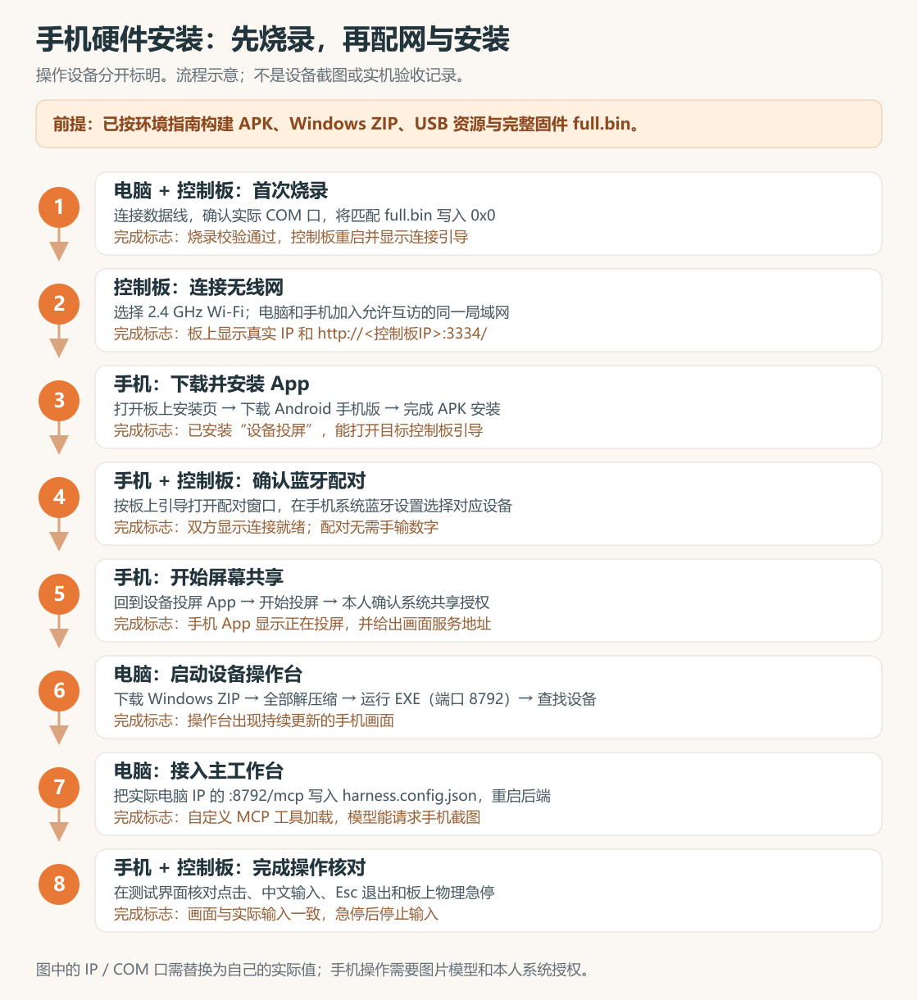

上图为安装顺序示意。下面的界面配图来自仓库 v55 的 LVGL 主机渲染及生产页面夹具，帮助辨认按钮；图中 IP、设备名以手头实物为准。

### 硬件步骤1：准备环境、构建并首次烧录

**操作设备：Windows 电脑 + 数据线连接的 AI Passport。**

全新克隆不包含 APK、EXE 或固件，需要先完成环境准备。按[硬件源码部署](docs/deployment.md#硬件源码部署)中的第一至第五步执行：

| 顺序 | 先准备什么 | 再执行什么 | 完成后得到 |
| --- | --- | --- | --- |
| 1 | JDK 17+、Android SDK Platform 34、Build Tools 36.0.0，配置本机 SDK/JDK 路径 | `npm run build:android:screen` | 手机 APK 与清单 |
| 2 | Rust 1.87+、MSVC C++ 工具与 Windows SDK；将输出目录设为 `windows/v56` | `npm run build:android:rust` | 电脑 EXE、ZIP 与清单 |
| 3 | Windows x64 MinGW-w64 GCC，设置 `QDD_USB_CC` | 生成 USB 下载器和离线接收页 | `usb-driver/v52` 与 `usb-browser/v55` 资源 |
| 4 | ESP-IDF 5.5.3、Git Bash、宿主 C 编译器，填写 `.idf.local.json` | `npm run check:esp`，通过后 `npm run build:esp` | 匹配的完整固件与调试归档 |
| 5 | 确认自己的板卡和 COM 口，进入 ESP-IDF PowerShell | 按指南把匹配 `full.bin` 写入 `0x0` | 控制板重启进入连接引导 |

**完成标志：**固件写入校验通过，控制板显示本项目的连接界面。每个阶段失败时先停下处理报错；完整命令、路径配置和产物位置见[分阶段构建](docs/deployment.md#第四步依次生成手机电脑及板上资源)与[首次烧录](docs/deployment.md#第五步首次烧录控制板)。

### 硬件步骤2：在控制板上连接无线网

**操作设备：控制板；电脑和手机加入同一局域网。**

1. 首次开机按引导选择「开始连接」，进入「连接无线网」；已进入主界面时走「设置 → 连接无线网」。
2. 选择 **2.4 GHz Wi-Fi** 并输入密码。密码页长按确认，打开「连接网络」菜单后执行连接。
3. 记下控制板显示的真实 IP。电脑、手机与控制板必须互相可达，访客网络的客户端隔离会阻止设备发现或投屏。

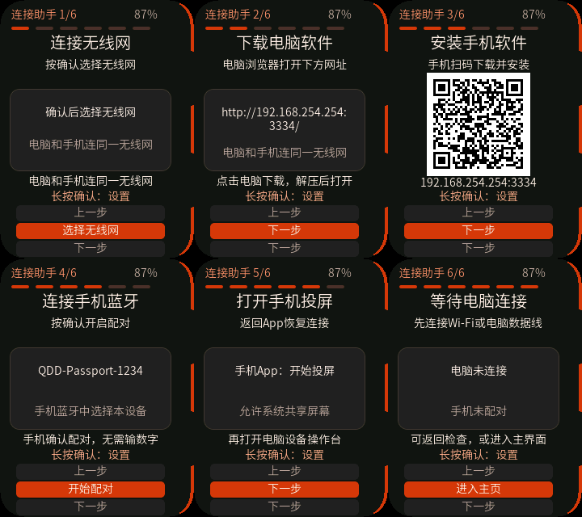

*控制板六页引导，v55 LVGL 主机渲染；图中的地址和蓝牙名称是示例。*

**完成标志：**控制板显示安装页 `http://<控制板IP>:3334/`，手机和电脑浏览器都能打开。

### 硬件步骤3：在手机上安装设备投屏 App

**操作设备：Android 手机。**

1. 扫描板上二维码或打开控制板安装页。
2. 点击「下载 Android 手机版」，等 APK 下载结束后打开，按系统提示允许从当前浏览器或文件管理器安装。
3. 安装完成后返回安装页，点击「打开设备投屏」。

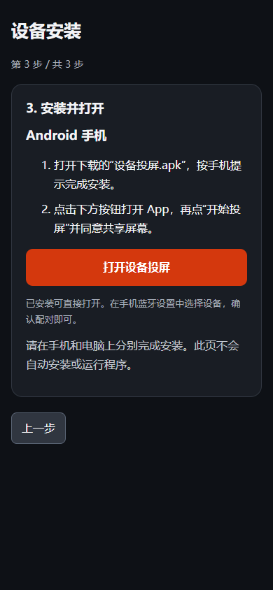

*手机安装页，v55 生产页面夹具渲染；不是手机系统授权截图。*

**完成标志：**手机已安装并能打开「设备投屏」，能看到设备控制器与屏幕共享相关入口。

### 硬件步骤4：配对蓝牙并开始投屏

**操作设备：控制板 + Android 手机。**

1. 在板上引导或设置中打开配对窗口。
2. 手机系统蓝牙设置中，选择**板上显示的对应设备名**，确认系统配对提示，无需手输数字。
3. 回到「设备投屏」App 的「设备控制器」卡片连接目标设备。板上完成配对后退出设置、返回主界面。
4. 在 App 的「屏幕共享」卡片点击「开始投屏」，由本人确认 Android 系统的共享屏幕授权。

**完成标志：**蓝牙显示就绪，App 显示正在投屏，并给出手机画面地址 `http://<手机IP>:8791`。系统蓝牙配对和屏幕共享是两次独立授权；具体 App 操作见[详细安装步骤](docs/deployment.md#第六步安装配网配对并完成演示)。

### 硬件步骤5：在电脑上安装并打开操作台

**操作设备：Windows 电脑。**

1. 浏览器打开同一个控制板安装页，点击「下载 Windows 电脑版」。
2. 下载完成后对 ZIP 选择「全部解压缩」，进入解压目录。
3. 在该目录打开 PowerShell，执行：

```powershell
.\设备操作台.exe --port 8792
```

4. 点击「自动查找手机与设备控制器」，确认目标设备，再点击「保存并打开操作台」。找不到时，按[详细安装步骤](docs/deployment.md#第六步安装配网配对并完成演示)手填控制板 IP 和手机画面地址。

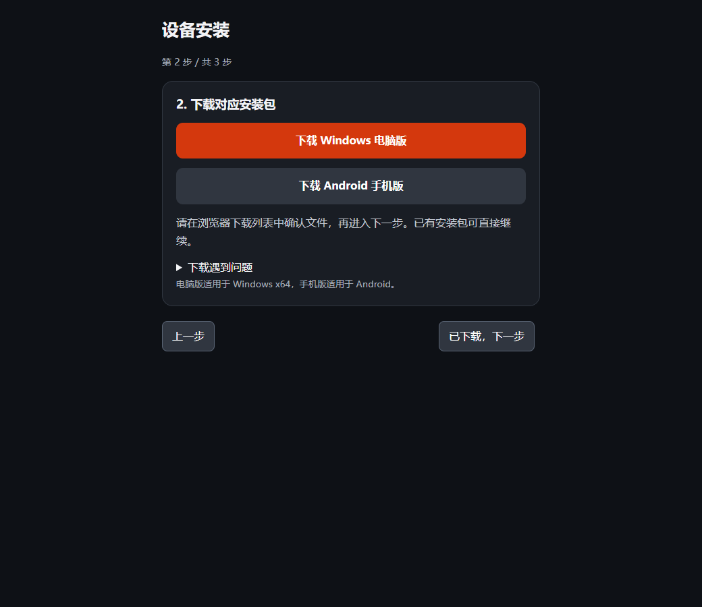

*电脑下载页，v55 生产页面夹具渲染。运行安装包无需 Node.js 或 Rust。*

**完成标志：**操作台中出现持续更新的手机画面。此处统一使用 `8792`，避开天翼服务默认占用的 `8790`。

### 硬件步骤6：让主工作台加载设备工具

**操作设备：Windows 电脑，项目配置文件与终端 A。**

1. 从设备操作台复制其显示的电脑局域网地址。
2. 编辑项目根目录 `harness.config.json`，把下方 `androidDevice` 条目加入已有 `mcpServers`，保留模型、网关和其他服务配置。示例 `192.168.1.20` 必须替换为自己的**电脑 IP**：

```json
{
  "mcpServers": {
    "androidDevice": {
      "url": "http://192.168.1.20:8792/mcp",
      "allowWrite": false
    }
  }
}
```

3. 终端 A 按 Ctrl+C 停止后端，再运行 `npm run dev`。电脑操作台和手机投屏继续保持运行。
4. 工作台中确认自定义 MCP 已加载，选择支持图片输入的模型，请求查看手机截图。

**完成标志：**助手能够调用设备工具获取当前手机画面。`allowWrite: false` 保留写入类操作的逐次授权。当前「门店手机」预设安装入口尚未开放，使用上述配置接入。

### 硬件步骤7：核对现场操作

**操作设备：手机 + 电脑操作台 + 控制板。**

- 选择一个无业务影响的测试界面，核对画面持续更新与指针定位；第一次点击用于进入控制，随后输入才传给手机。
- 需要中文输入时，由本人在手机中启用并选择配套「设备中文输入」输入法，在空白文本框核对实际文字。
- 按 Esc 退出电脑控制，再触发控制板物理急停，确认输入停止。物理急停只能在控制板上解除。

**完成标志：**实际画面与输入一致，退出和急停均生效。摄像头是另一条接入链路，按[真实门店系统](#接入真实门店系统)核对自己的设备列表、取图和模型分析。

模块说明：[Android App](apps/android-screen/README.zh_CN.md) · [Rust 操作台](apps/android-mcp-rust/README.zh_CN.md) · [ESP 固件](apps/esp/README.zh_CN.md)。

## 默认技能

工作台侧栏的「技能」（`/skills`）默认提供 `android-operator` 和 `xiaohongshu-hid-control`，标记为「内置 · 默认已加载」。新会话会自动获得完整操作说明，无需先手动导入或调用 `load_skill`；原有自建技能仍按需加载。技能页可以查看完整说明，也可以运行技能打开新对话。

原始文档及小红书配套 `agent.py` 保存在根目录 `skills/`，内置技能随项目更新，不写入或覆盖运行时用户技能，也不能在工作台编辑、删除。操作设备前仍需接入相应 MCP，并使用支持视觉及工具调用的模型；默认加载不代表已连接设备或自动执行任何操作。

手机操作的统一方法见 [skills/android-operator/METHODOLOGY.md](skills/android-operator/METHODOLOGY.md)，随 Android 技能全文默认加载，并已合入主技能、通用提示词、四大能力及小红书操作说明。它要求换设备重测画像、按页面锚点识别状态、点击前检查新整屏与目标局部图、区分模拟标记与真实指针、按失败类型处理并保存前后证据；中文仍使用 QDD 输入法通道。

默认技能与已有用户技能的存储、完整上下文加载回归位于 `apps/cli/src/builtin-skills.test.ts`，通过 `npm test` 执行。技能页回归可用 `node --test apps/web/tests/skills-view.test.mjs` 执行。

## 仓库结构

```text
apps/cli/               Agent、网关、数据集、技能与调度
apps/web/               Vue / Element Plus 工作台
mcp/                    监控与收钱吧的独立 MCP 连接器
apps/android-screen/    Android 投屏、校准与配套输入法
apps/android-mcp-rust/  Rust Windows 设备操作台与视觉 MCP
apps/android-mcp/       TypeScript 设备 MCP 与桌面对照实现
apps/esp/               AI Passport ESP32-C3 固件
packages/shared/        共享类型、计算引擎与页面通信协议
skills/                默认 Android / 小红书技能、完整参考文档及配套脚本
docs/deployment.md      完整部署、配置与排错指南
docs/product-development.md  硬件产品开发说明书与参赛材料状态
docs/api.md             前端与生成页面 API
docs/assets/hackathon/  参赛演示视频、界面素材与设备照片
workspace/              运行时数据、任务页面、会话和本地密钥
```

`workspace/`、本地 `.env`、`harness.config.json` 和连接器的 `mcp/.local/` 不进入 Git。部署备份时应保留运行数据与本地密钥；公开演示素材与实际门店数据分开保存。

## 当前范围

仓库已包含软件与硬件链路的源码、构建脚本和回归测试。内置收钱吧工具以只读经营查询为主；ERP、外卖平台及其他系统可通过自定义 MCP 扩展，具体能力取决于账号权限和适配器。

手机兼容性、无线稳定性、视觉判断和真实业务执行需要结合实际设备与账号验证。演示视频、源码构建和离线测试分别说明不同范围，实机记录见[设备验收文档](apps/android-mcp/docs/acceptance.zh_CN.md)。

[部署与排错](docs/deployment.md) · [连接器配置](mcp/README.md) · [API 契约](docs/api.md) · [表格附件说明](docs/excel-attachments.md)
