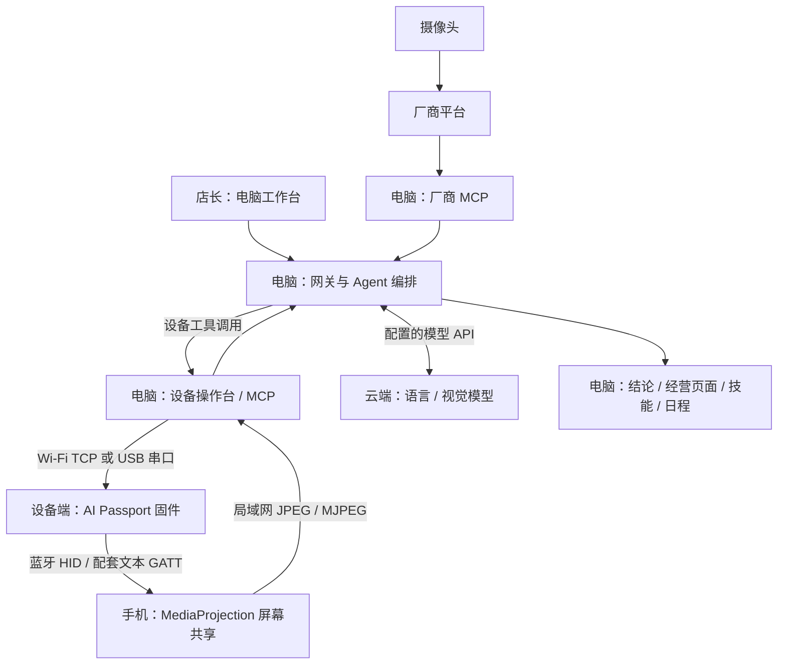
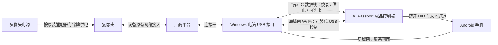

# 钱多多 · AI 设备联动产品开发说明书

**参赛赛道：AI 设备联动。** 本文按赛事第 7.5 节的八项要求编排，并补充设备联动所需的设备清单、接入协议和改造前后对比。安装命令与界面步骤见[部署与评委复现指南](deployment.md)，项目入口见 [README](../README.md)。

**当前材料状态：**源码、部署步骤、设备实物照片和安装界面图已整理；最终设备数量、赛前已有情况、结构改造情况、完整实机联动视频及关卡过程照片仍需补充。下文的“待确认 / 待提交”表示材料尚未核实，不代表已经完成该项验收。

## 1. 作品概述

钱多多是一套面向门店经营的 AI 工作台。店长用自然语言描述目标，助手通过已授权的收银、监控和浏览器工具取数，生成经营页面，并把重复流程保存为技能或定时任务。

对于缺少专用接口的手机应用，项目增加一条设备操作链路：手机主动共享屏幕，电脑把当前画面交给支持图片输入的模型；模型通过设备工具提出操作，由 AI Passport 控制板经蓝牙向手机发送鼠标、键盘或配套中文输入。

**典型交互流程：**

1. 店长在电脑工作台提出任务。
2. 助手确认目标和统计口径，调用授权数据工具或获取手机 / 摄像头画面。
3. 需要手机操作时，由使用者确认权限，控制板执行输入，电脑获取更新后的画面。
4. 助手继续检查结果，输出结论、经营页面或保存可复用流程。
5. 使用者可退出控制、停止投屏，或通过板上按键锁定并释放输入。

### 联动前后对比

| 环节 | 联动前的使用方式 | 本项目提供的联动方式 |
| --- | --- | --- |
| 经营数据 | 人在多个业务界面中查询、整理 | 助手调用授权工具取数，并生成可交互页面 |
| 现场观察 | 人打开摄像头平台逐个查看 | 助手获取授权画面，交给视觉模型分析 |
| 手机 App | 人看屏幕并逐次点击、输入 | 手机投屏提供画面，电脑编排任务，控制板发送蓝牙输入 |
| 重复任务 | 人记住步骤并每天重复 | 经确认的流程保存为技能或定时任务 |
| 执行中止 | 分别退出各个界面 | 操作台 Esc 退出、手机停止投屏、板上输入锁定分别控制对应环节 |

此表说明交互与架构变化，不是效率提升或成功率的实测结论。实际联动效果需用第 8 节的实机录像证明。

## 2. 元器件与联动设备清单

下表列出当前原型涉及的设备。**实际数量与赛前已有情况尚未从材料中确认，应由参赛团队填写后作为最终清单提交。** “参赛获得”不擅自改写为某种领取渠道。

| 名称 | 型号 / 规格 | 实际数量 | 来源 | 是否开赛前已有 |
| --- | --- | --- | --- | --- |
| 控制板 | FoloToy AI Passport；ESP32-C3、8 MB Flash、无 PSRAM | 待确认 | 原始参赛素材记载“参赛获得”，具体领取方式待确认 | 待确认 |
| 被控手机 | OnePlus 8 / IN2010；Android 13，12 GB + 256 GB | 待确认 | 待确认：自带 / 现场领取 / 兑换等 | 待确认 |
| 场内摄像头 | 海康 HK-Q3S4LW-GL/L；4 mm、400 万像素、4G | 待确认 | 原始素材记载 20 AI DOL 币兑换 | 待确认 |
| Windows 电脑 | Windows 10 / 11；设备操作台为 Windows x64；实际型号待确认 | 待确认 | 待确认 | 待确认 |
| USB 数据线 | 连接电脑与控制板的 Type-C 数据线；具体规格待确认 | 待确认 | 待确认 | 待确认 |
| 网络设备 | 允许电脑、手机、控制板互访的局域网；控制板使用 2.4 GHz Wi-Fi | 待确认 | 待确认 | 待确认 |
| 摄像头电源 / 支架 | 按最终实物铭牌填写型号与供电规格 | 待确认 | 待确认 | 待确认 |

AI Passport 原厂资料记载 USB Type-C 2.0、**5 V 输入**，内置 **500 mAh 可充锂电池**与 CW2017 电量计；它们是成品板内置部分，不另算外接采购件。资料见[原厂硬件规格](../apps/esp/docs/hardware-design/specifications.zh_CN.md)。电池标称电压、充电电流和当前电池状态不能由上述容量推断。

| 控制板实物 | 手机实物 | 摄像头实物 |
| --- | --- | --- |
|  |  |  |

三张为团队提供的设备静态照片，不能单独证明数量、获得时间或某次联动已成功。

## 3. 系统架构与接入协议

### 感知 → 处理 → 执行

| 部署位置 | 负责什么 |
| --- | --- |
| 手机端 | 系统授权的屏幕采集、局域网投屏服务，以及本人启用的配套输入法 |
| 控制板端 | Wi-Fi、USB 与蓝牙桥接；配网和安装引导；输入释放与锁定 |
| Windows 电脑 | 工作台、网关、Agent、厂商连接器、设备操作台、任务页面和本地运行数据 |
| 配置的模型服务 | 根据发送的文字与图片进行推理；不把控制板描述为板载大模型 |
| 厂商平台 | 提供账号授权范围内的经营数据、设备列表和摄像头能力 |

### 联动设备接入协议

| 链路 | 协议 / 地址 | 交换内容与前提 |
| --- | --- | --- |
| 工作台 → 网关 | HTTP / SSE，示例端口 `3000` | 对话、任务、事件；工作台使用网关 token |
| Agent → 设备操作台 | MCP Streamable HTTP，本文统一使用 `http://<电脑IP>:8792/mcp` | 截图、设备状态与控制工具；写入类操作保留工作台授权 |
| 电脑 → 控制板 | `QDDHID/1` 行协议；Wi-Fi TCP `3333` 或 USB Serial/JTAG | 鼠标、键盘与控制状态；同时只使用一个控制源 |
| 控制板 → 手机 | 蓝牙 HID | 使用手机系统确认的配对与绑定；需真实连接、加密和 HID 就绪 |
| 中文输入 | `QDDTXT/1` → 加密 BLE 文本 GATT → 配套输入法 | 本人启用并选中输入法；收到接受状态后仍需查看实际输入框 |
| 手机 → 电脑 | 手机 HTTP `8791`，`/stream.mjpg` 与 `/frame.jpg` | MJPEG 预览 / 新采集原尺寸 JPEG；需 Android 屏幕共享授权 |
| 电脑 / 手机 → 控制板 | 控制板 HTTP `3334` | 安装页、APK / ZIP 下载与设备登记 |
| 局域网设备发现 | UDP `3335`，`QDD-DISCOVER/1` | 发现和选择目标设备；多设备时明确确认对象 |
| 厂商连接器 | 各平台 HTTP MCP；海康 `8787`、收钱吧 `8788`、天翼 `8790`、萤石 `8791` | 平台登录、账号权限与连接器安装分别完成 |

设备操作台默认是 `8790`，会与同一电脑上的天翼服务冲突，因此图解统一改为 `8792`。手机的 `8791` 与电脑萤石的 `8791` 属于不同主机。

蓝牙采用 Just Works 配对，不需手输数字，也不提供配对码带来的中间人认证保证。局域网设备 HTTP / TCP 服务当前没有应用 token / TLS，复现使用允许互访的预期私网。协议实现与配置详见 [Android App](../apps/android-screen/README.zh_CN.md)、[设备操作台](../apps/android-mcp-rust/README.zh_CN.md)和 [ESP 固件](../apps/esp/README.zh_CN.md)。

## 4. 接线与结构件

### 外部接线与无线连接图

图中有线部分为电脑与成品控制板的 USB 连接，以及摄像头按铭牌配置的供电；无线箭头表示通信关系，不是电气导线。手机 USB 仅作为安装 / 调试的可选方式，正常投屏不依赖 ADB。

本仓库复现流程不要求新加外部传感器、继电器或焊接引线。是否在最终实物上做过改线、焊接或自制固定件仍待团队确认；不能据此断言实物从未改装。

| 结构资料 | 当前状态 |
| --- | --- |
| 控制板原厂硬件规格与接口说明 | 已有：[规格](../apps/esp/docs/hardware-design/specifications.zh_CN.md)、[硬件开发指南](../apps/esp/docs/hardware-design/AI_HARDWARE_DEVELOPMENT_GUIDE.zh_CN.md) |
| 本项目新增接线 / 焊接原理图 | 是否存在待确认；如有，需补最终实物对应的清晰图纸 |
| 3D 打印 / 外壳 / 支架工程文件 | 是否存在待确认；如有，补 STL / STEP 等文件及实物对应照片 |
| 最终整套装置接线照片 | 待提交，应能看清电源、USB 连接和设备位置 |

## 5. 软件、固件与复现

源码仓库：[HBAI-Ltd/qdd_agent_harness_project](https://github.com/HBAI-Ltd/qdd_agent_harness_project)。提交时应注明实际演示使用的提交版本，并保留匹配 APK、Windows ZIP、固件与哈希清单。

| 模块 | 仓库路径 | 主要内容 |
| --- | --- | --- |
| Agent / 网关 | `apps/cli/` | 模型调用、工具编排、权限、会话、技能与调度 |
| 工作台 | `apps/web/` | 对话、任务页面、连接器与设置 |
| 厂商连接器 | `mcp/` | 摄像头与收钱吧接入 |
| 手机 App | `apps/android-screen/` | 屏幕共享、校准与配套输入法 |
| Windows 操作台 | `apps/android-mcp-rust/` | 原生设备操作台与视觉 MCP |
| 控制板固件 | `apps/esp/` | ESP32-C3 配网、安装页、蓝牙输入和输入锁定 |

复现入口：

1. [软件七步部署](../README.md#快速部署)：环境 → 源码 → Key → 后端 → 前端 → 连接 → 虚构样例看板。
2. [硬件分阶段构建与烧录](deployment.md#硬件源码部署)：Android、Rust、USB 资源、ESP 固件分别构建，再写入目标板。
3. [图解安装与配对](deployment.md#第六步安装配网配对并完成演示)：按设备分开操作并逐项核对结果。

部署指南列出了环境版本、本机路径配置、命令、界面按钮、输出产物和成功标志。当前硬件安装包按源码生成；控制板烧录且联网后才提供板上下载页。

## 6. 安全说明

| 项目 | 已知边界与演示处理 |
| --- | --- |
| 供电与电压 | AI Passport 原厂规格为 USB Type-C 5 V 输入。使用符合该输入规格的数据线与供电设备；摄像头按最终实物铭牌和适配器规格供电，不推断为 12 V 或 PoE |
| 电池 | 控制板内置 500 mAh 可充锂电池。当前材料没有电池健康、续航、充电电流或保护电路的实测 / 认证记录；不拆卸、穿刺或自行改接电池 |
| 发热 | 尚未提交持续负载与充电过程的温升记录。演示中检查异常发热、异味或外壳 / 电池异常，发现异常时停止使用并断开外部供电 |
| 加工工序 | 最终实物是否涉及焊接、切削、打印或改线待确认；如有，需补工序、材料与相应防护说明 |
| 手机输入 | 选择有权限且无业务影响的测试界面；确认目标设备后再控制，系统配对 / 共享屏幕 / 输入法选择由本人完成 |
| 停止机制 | 板上按键触发输入锁定和释放；Esc 退出电脑控制，手机可停止投屏。板上“急停”不是切断电源的安全回路，也不是安全认证声明 |
| 断链与权限 | 控制租约超时、断链或进入相关配置状态时停止继续发送输入；链路可用时发送中立释放。蓝牙已断开时无法保证释放报告送达，需核对手机实际状态 |

上述是当前设计与演示操作边界。实际电池状态、温升和最终装置加工情况仍需团队提供实物记录。

## 7. 已知限制与模拟部分

| 项目 | 当前范围 |
| --- | --- |
| 虚构经营样例 | `judge-sales.csv` 是评审用虚构数据；生成页面应标注“附件快照，非实时门店数据” |
| 产品界面素材 | 归档中的 ERP、外卖等入口属于产品演示方向，不代表所有平台都已内置接入 |
| 安装界面配图 | 新增三张 v55 图片是 LVGL 主机 / 生产页面夹具渲染，用于安装说明，不是手机系统授权或实机通关照片 |
| 模型与数据 | 依赖实际模型 API、图片输入和工具调用能力；真实业务数据还取决于账号、设备权限与适配器 |
| 手机兼容性 | 原型目标是 OnePlus 8 / Android 13；其他手机需验证配对、投屏、指针校准及中文输入 |
| 局域网 | 手机、控制板与电脑需允许互访；网络隔离、无线质量和 IP 变化影响发现与投屏 |
| 视觉操作 | 模型可能误判画面或目标；一次点击 / 输入需通过更新后的真实画面确认 |
| 长期稳定性 | 源码构建和已有短时记录不能替代当前最终版本的持续运行、帧率和温升测试 |
| 实机证据 | 现有产品介绍视频与设备静态照片尚不能替代完整实机联动录像和各关卡过程照片 |

## 8. 实机视频与各关卡过程照片

### 已归档资料

| 资料 | 入口 | 可说明的内容 |
| --- | --- | --- |
| 产品介绍视频 | [product-demo.mp4](assets/hackathon/product-demo.mp4) | 产品交互和方向；是否包含最终实机联动片段及时间段待确认 |
| 设备静态照片 | [控制板](assets/hackathon/passport.jpg)、[手机](assets/hackathon/phone.jpg)、[摄像头](assets/hackathon/camera.jpg) | 展示实物外观 |
| 安装说明图 | [控制板六步引导](assets/hackathon/board-onboarding-v55.png)、[电脑下载页](assets/hackathon/install-desktop-v55.png)、[手机安装页](assets/hackathon/install-mobile-v55.png) | 说明安装步骤；均标注为 v55 界面渲染 |
| 历史验收记录 | [设备验收文档](../apps/android-mcp/docs/acceptance.zh_CN.md) | 区分主机夹具、构建、历史实物记录及未验证边界；不是最终提交视频 |

### 待提交的现场证据

以下按演示环节整理，**官方关卡名称和对应照片需由团队填写**，不把这些自拟环节冒充赛事关卡。

| 演示环节 | 建议镜头 / 过程照片 | 当前材料 |
| --- | --- | --- |
| 整套装置与接线 | 同一画面展示电脑、控制板、手机、摄像头与供电 / 数据线 | 待提交；填写对应关卡名、时间与结果 |
| 配网与安装 | 板上真实 IP、手机安装 App、电脑解压操作台 | 待提交实物过程照片 |
| 蓝牙与投屏 | 手机系统确认、板上状态、电脑持续更新的手机画面 | 待提交实机录像 / 照片 |
| AI 发起并执行操作 | 工作台任务与工具记录、控制板、手机可见响应在同一段视频中对应 | 待提交完整联动视频及演示版本 |
| 摄像头联动（如演示） | 实物摄像头、自己账号下的设备、获取的画面与分析结果 | 待提交；不拍摄无关人员或隐私内容 |
| 退出与急停 | Esc 退出、板上按键锁定、输入停止的可见结果 | 待提交实机片段 |

提交视频时注明仓库提交版本、APK / EXE / 固件清单及关键片段时间点。正式提交前，把设备清单中的待确认项和此处的待提交项补齐；若没有自制结构件或改线，应由团队明确写明，而不是用空白代替。
