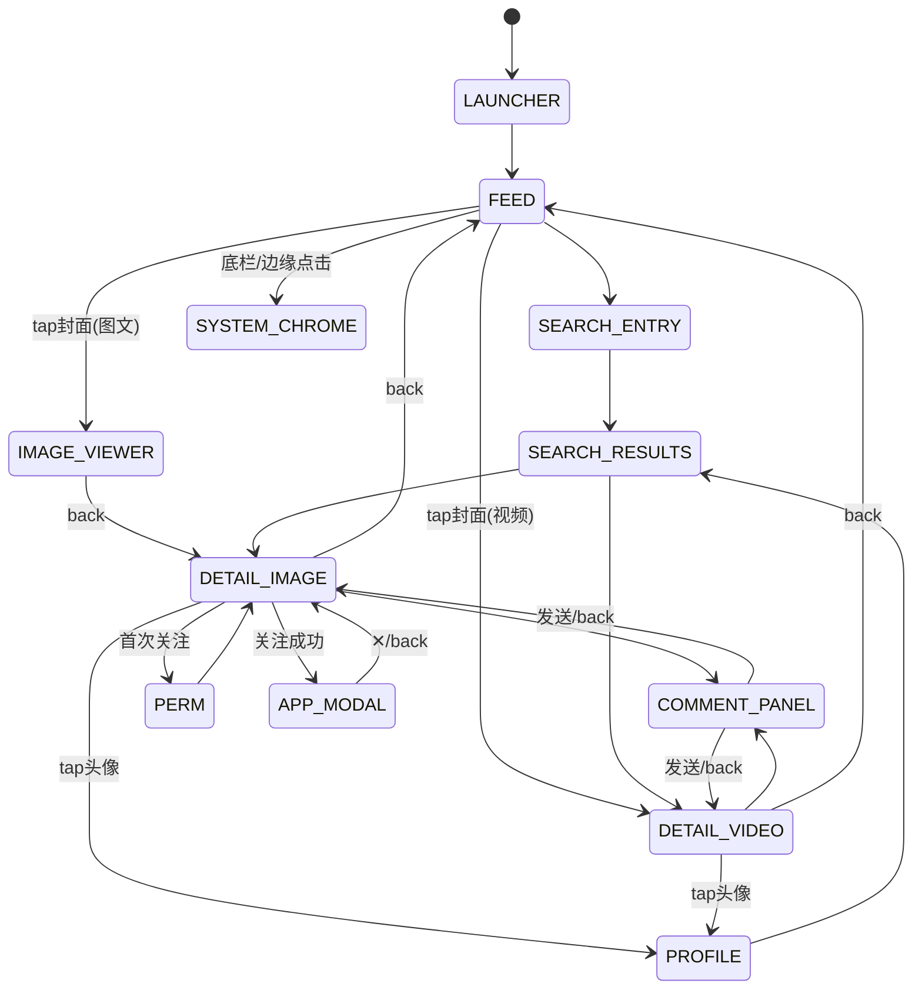

# 小红书真机 HID 自动化

服务端只给**相对位移**，且只知道指针的**估算**位置。所有坐标必须靠闭环或标定才能变成真的。

> 本技能已在**两款差异极大的设备**上实测：一台手机（1080×2400，增益 1:1，灰圆点指针）与一台平板（1904×3040，增益 2:1，白箭头指针）。
> 两台的坐标、指针形态、滚动方式、可用区域**全都不同**——所以**设备画像必须重推，不能沿用**。

配套：`agent.py`（闭环驱动）

---

## 第 0 步：校准（跳过它后面全错）

这是本技能最容易静默失败的地方。**校准参数是「每像素多少 HID 计数」，等于 1/增益**。
手机增益 1:1 → 校准 **1**；平板增益 2 像素/计数 → 校准 **0.5**。

用 1 去校准一台 2× 的设备时：服务端会把所有坐标放大一倍，**没有任何报错**，
表现是"点 A 打开 B""拖拽起点被顶到屏幕边缘触发系统手势"。我在平板上一开始就栽在这里。

### 0.1 量增益
```powershell
py agent.py shot                                   # 取帧
py agent.py cal 1 1 0                              # 先用 1 占位（pointer_home 需要已校准）
py agent.py home                                   # 归零：大幅负位移被屏幕边缘 clamp，与增益无关
py agent.py move 500 500                           # 移动
# 读图找指针：指针尖端/圆心的像素落点 ≈ 500 × 增益
```
- 手机（1080×2400）：落点≈500px → 增益 1 → **校准 1**
- 平板（1904×3040）：落点≈1000px → 增益 2 → **校准 0.5**

### 0.2 校准后必须验证
```powershell
py agent.py cal 0.5 0.5 0        # 平板
py agent.py blindswipe 500 500 500 500 100   # 原地按压：既点击又把指针画出来
# 读图：指针应该在 (500,500) 附近
```
实测平板落在 (515,511)，误差约 15px（屏幕宽 1904）——可用。
**误差 >40px 说明增益估错，必须重来**，不要带着偏差继续。

---

## 第 1 步：设备画像（每次换设备都要重推）

| 项 | 手机 OnePlus IN2010 | 平板 LENOVO TB322FC |
|---|---|---|
| 分辨率 | 1080×2400 | 1904×3040 |
| 截图预览 | 838×1862（×1.2888） | 999×1596（×1.906） |
| 指针像素/计数 | 1 | 2 |
| 校准值 | 1 | 0.5 |
| 指针形态 | 66px 半透明**灰圆点**，圆心=热点 | 细白**箭头**，尖端=热点 |
| 指针入镜 | **总是**渲染，可用差分定位 | **只在按压/拖拽后**短暂出现，纯移动不渲染 |
| 可行的定位方式 | 视觉闭环（差分读回指针） | **归零 + 盲走 + 效果校验** |
| 滚动 | 滚轮 `scroll` 有效 | 滚轮**无效**，必须拖拽，且**起点避开底部手势区** |
| 信息流 | 双列 | **三列** |
| 顶栏 | 关注 / 发现 / 同城 + 搜索图标 | 关注 / 发现 / **视频** + **搜索输入框** |
| 底部 Tab | 可点 | **被系统手势条吞掉，不可点** |
| 底部动作栏 | 可点 | 被自动隐藏的 **Dock** 覆盖，基本不可点 |

> 结论：**先花 3 次调用确认这 8 行，再动手**。省下的时间远多于踩坑。

---

## 第 2 步：四条铁律

| # | 铁律 | 违反后果 |
|---|---|---|
| **1** | **每个动作后必须截图**；导航类动作**延时 ≥0.55s** 再取帧 | 0.15s 取帧仍是旧页面 → 误判"没生效" → 补点 → **多退一层 / 重复提交** |
| **2** | **点击 = 两份 HID 报告**：按下 → 70ms → 抬起 | 合并成一份安卓认为按钮没变，**动作静默丢失** |
| **3** | 单步 ≤120 **计数**（按校准折算成像素） | 超过会被系统加速约 2×，来回振荡 |
| **4** | 只有 `actionStarted === false` 才允许重试 | `actionCompleted:true` 但图像超时时重放 = 重复执行 |

**状态没变时的判定顺序**：
```
指针确实在目标上 + 已过 0.55s → 真没生效 → 允许再点（仅幂等操作）
指针不在目标上                → 定位失败，重新归零，不要补点
动作后 <0.55s 取的帧          → 不算数，重新取帧
目标被系统 chrome 遮挡        → 报告遮挡，不要重试（见故障 G）
```
**非幂等操作（评论/发送/发布）永远不许补点**，只能回读状态。

---

## 第 3 步：状态机

### 3.1 状态（按布局族标注差异）

| 状态 | 识别锚点 | 手机 | 平板 |
|---|---|---|---|
| `LAUNCHER` | 图标网格 + 底部搜索 | 有 | 有（含 Dock、多页） |
| `FEED` | 顶栏 Tab + 底栏五宫格 + 瀑布流 | 双列 / `关注 发现 同城` | **三列 / `关注 发现 视频`** |
| `SEARCH_ENTRY` | 输入框 + 历史记录 + 猜你想搜 | 搜索**图标**进入 | 顶部**输入框**直接点 |
| `SEARCH_RESULTS` | 查询词回显 + `全部/用户/商品/图片` | 有 | 有 |
| `IMAGE_VIEWER` | 全黑 + `n/m` + 左上 ✕ | 有 | 有 |
| `DETAIL_IMAGE` | 顶栏作者栏 + 底栏 ❤★💬 | 有 | 有 |
| `DETAIL_VIDEO` | 全屏视频 + **左下**作者行含关注 | 有 | 有（关注文案为「立即关注」） |
| `PROFILE` | 大头像 + 小红书号 + 三列计数 | 有 | 有 |
| `COMMENT_PANEL` | 输入框 + 工具栏 + 发送 | 有 | 未验证 |
| `VOICE_PANEL` | 白色上滑面板 + 按住发语音 | 有 | 未验证 |
| `PERM` | 系统权限框 `禁止/确认` | 有 | 未验证 |
| `APP_MODAL` | 白卡片 + 红色确认 + ✕ | 有 | 未验证 |
| `SYSTEM_CHROME` | 手势条高亮 / Dock 弹出 / 侧栏 | — | **平板高频** |

### 3.2 主转移

| 从 | 动作 | 到 | 校验 |
|---|---|---|---|
| `LAUNCHER` | tap 小红书图标 | `FEED` | 底栏五宫格出现 |
| `FEED` | tap 封面 | `IMAGE_VIEWER` / `DETAIL_VIDEO` | 页码 `1/1` 或左下作者行 |
| `FEED` | tap 搜索 | `SEARCH_ENTRY` | 出现历史/猜你想搜 |
| `SEARCH_ENTRY` | tap 词条 或 输入后 tap 搜索 | `SEARCH_RESULTS`（人物热词会跳 `PROFILE`） | 输入框回显该词 |
| `SEARCH_RESULTS` | tap 卡片 | 详情 | 作者+标题与卡片一致 |
| `IMAGE_VIEWER` | back / ✕ | `DETAIL_IMAGE` | 出现底栏 ❤★💬 |
| `DETAIL_*` | tap ❤ | 同态 | 心变实心红、计数 +1 |
| `DETAIL_*` | tap ★ | 同态 | 星变实心金黄、计数 +1（**无收藏夹弹层**） |
| `DETAIL_*` | tap 关注（权限未定） | `PERM` | 系统权限框 |
| `PERM` | tap 禁止 | `DETAIL_*` | 按钮**仍是「关注」**（被中止），需再点一次 |
| `DETAIL_*` | tap 关注（权限已定） | 同态 + `APP_MODAL` | 按钮变「已关注」 |
| `APP_MODAL` | ✕ / back | `DETAIL_*` | 浮层消失，页面不退出 |
| `DETAIL_*` | tap 头像 | `PROFILE` | 昵称+小红书号与入口一致 |
| `DETAIL_*` | tap 说点什么 | `COMMENT_PANEL` | 占位"爱评论的人运气都不差" |
| `COMMENT_PANEL` | 输入后 tap 发送 | `DETAIL_*` | 面板收起 + 输入框清空 + 💬 **+1** |
| 任意层 | back | 上一层 | 见 §5.7 |
| 底栏/动作栏附近 | tap | `SYSTEM_CHROME` | 手势条高亮 / Dock 弹出 → **回退，改用其他路径** |



---

## 第 4 步：原语

```powershell
$py = "C:\Users\1\.dsh\dsh-runtimes\dsh-primary-runtime\dependencies\python\python.exe"

& $py agent.py shot                  # 取帧（每个动作后都做）
& $py agent.py cal SX SY ROT         # 校准，SX=1/增益
& $py agent.py arm                   # 换设备后先显式 arm
& $py agent.py home                  # 归零（边缘 clamp，与增益无关）
& $py agent.py move DX DY            # 一次相对移动

& $py agent.py goto X Y              # 视觉闭环移动（指针必须入镜）
& $py agent.py tap X Y [safe]        # 闭环 + 拆分点击
& $py agent.py blindtap X Y          # 归零 + 盲走 + 点击（指针不入镜时用）
& $py agent.py blindswipe X1 Y1 X2 Y2 [MS]   # 盲走 + 拖拽
& $py agent.py click                 # 原地点击
& $py agent.py scroll ±N             # 滚轮（手机有效，平板无效）
& $py agent.py back | homekey        # 已内置 0.55s 沉降
& $py agent.py type "ascii"          # 仅 US 布局
& $py agent.py key "ctrl+a" | backspace
& $py agent.py longpress X Y [ms]
& $py agent.py gain GX GY            # 驱动侧像素/计数比
& $py agent.py staleframe            # 验证过期帧不会执行
```

**选闭环还是盲走**：指针入镜（手机）→ 闭环更快更稳；指针不入镜（平板）→ 只能盲走，并用点击效果校验。

---

## 第 5 步：操作配方

### 5.1 打开帖子
```
tap 封面 → 图文: IMAGE_VIEWER → back → DETAIL_IMAGE
            视频: DETAIL_VIDEO 直接进入
校验：作者 + 标题 + ❤数 与卡片一致
```
> **慢速定位的风险**：盲走一次要 20–30s，信息流可能在这期间刷新。
> 实测平板上有一次点开的是**另一篇**（作者完全不同）。所以"核对作者"不是可选项。

### 5.2 点赞
```
DETAIL_*: tap ❤     或   FEED: tap 卡片❤（列表坐标现测）
先把指针移开再核对：心变实心红 + 计数 +1
```

### 5.3 收藏
```
DETAIL_*: tap ★ → 实心金黄 + 计数 +1
没有收藏夹弹层；长按 = 取消收藏，不要用长按
```

### 5.4 关注
```
权限未定：tap 关注 → PERM → tap 禁止 → 仍是「关注」 → 再 tap 一次 → 已关注 + APP_MODAL
权限已定：一次点击即生效
收尾：关掉推送引导浮层（✕ 或 back），页面不应退出
```

### 5.5 提交评论
```
tap 说点什么 → COMMENT_PANEL
type 中文或英文 → **重新截图回读输入框，逐字核对** → tap 发送
校验：面板收起 + 输入框清空 + 💬 +1
空输入时发送为灰色禁用，有输入才变红——用颜色判断
```
中文可直接通过 `android_type({text:"很喜欢这个分享"})` 或 `android_control({action:"type",text:"很喜欢这个分享"})` 输入。先确认新版 ESP 固件/投屏 App 就绪、用户已启用并选择 QDD 输入法、输入框已聚焦。非 ASCII 整串须为合法 UTF-8、无 NUL，最多 512 字节。`accepted` 只代表输入 API 接受，仍须截图核对；`uncertain`、超时或断线时禁止自动重发，先观察当前内容。

### 5.6 搜索
```
中文/英文：点击输入框 → 确认焦点 → type 原文 → 新截图回读校验 → 点击搜索
中文示例：android_control({action:"type",text:"淮北采耳店"})
配套脚本：py agent.py type "淮北采耳店"
```
- 中文已支持直接输入，使用上述 QDD 输入法通道；不再默认改成拼音或仅依赖「猜你想搜」/「历史记录」。缺少固件/IME 或焦点时按实际错误排查，不把输入故障当作“不支持中文”。
- **空结果没有空态**：小红书回落推荐流。判定"无结果"只能靠结果是否含关键词。
- 一次提交只产生一条历史记录 → 可用"历史是否重复"证明没重复提交。

### 5.7 返回
| 场景 | 做法 | 期望 |
|---|---|---|
| 搜索/详情/主页 | `back`（内置沉降） | 退一层 |
| 弹层/面板开启 | `back` | **只关弹层，页面不退出** |
| `back` 疑似无效 | 先重取帧确认，再考虑 `‹` | 只补一次 |
| 视频详情 | `back` | 回 `FEED`，停在原卡片 |

> `back` 与页面内 `‹` **不要连用**：两个都生效会多退一层（踩过）。

### 5.8 滚动
- 手机：`scroll -N`（1 次调用，最省）
- 平板：`blindswipe` 拖拽，**起点必须在屏幕中段**（y≈40%–60%），
  终点不要进入底部手势区，否则会被识别成"上滑回桌面"

---

## 第六步：故障分类

| 代号 | 症状 | 真因 | 处置 |
|---|---|---|---|
| **A** | 整体偏移约一倍、点 A 得 B、拖拽起点跑到屏幕边缘 | **校准值填成了 1 而设备是 2×** | 按 §0 重算 `1/增益` 重新校准 |
| **B** | 点了没反应 | ①截图早于转场 ②指针没到目标 ③按下/抬起被合并 | 按 §2 判定顺序；②重定位；③拆分点击 |
| **C** | 多退了一层 | `back` 后误判无效又点了 `‹` | 导航后延时 0.55s 再判断，禁止连用 |
| **D** | 重复提交 | 非幂等操作补点 | 只能回读确认，不能补点 |
| **E** | 文本内容错 | HID 丢字符（实测 2/9、3/13） | 输入后回读；错则 `ctrl+a`+`backspace` 重输 |
| **F** | 计数没变但心是红的 | 指针遮挡读数 | 先 `goto` 移开指针再取帧 |
| **G** | 点击只点亮手势条 / 弹出 Dock / 弹出系统侧栏 | **目标被系统 chrome 覆盖** | 该坐标不可用，换入口或换设备方向；不要重试 |
| **H** | 盲走到达后打开的是别的帖子 | 信息流在 20–30s 定位期间刷新 | 开帖后必须核对作者+标题，不一致就退回 |
| **I** | 命令卡住 | 检测连续失败反复归零 | 驱动已加 45s 硬超时 + 重试上限 |

---

## 第七步：坐标表（**分设备，不可混用**）

### 手机 OnePlus IN2010 · 1080×2400 · 校准 1
| 界面 | 元素 | 坐标 |
|---|---|---|
| FEED | 汉堡/关注/发现/同城/搜索 | (77,144)/(322,146)/(535,146)/(734,148)/(1012,148) |
| FEED | 底栏 首页·市集·＋·消息·我 | (88,2307)/(309,2307)/(541,2290)/(767,2307)/(941,2307) |
| DETAIL_IMAGE | ‹/头像/关注/分享 | (58,187)/(161,168)/(814,190)/(987,187) |
| DETAIL_* | 说点什么/❤/★/💬 | (238,2307)/(548,2301)/(728,2307)/(892,2307) |
| DETAIL_VIDEO | 左下关注 | (599,1957) |
| SEARCH | ‹/输入框/搜索/清空 | (84,187)/(500,187)/(928,187)/(809,187) |
| PROFILE | ‹/关注 | (84,177)/(299,760) |
| PERM | 禁止/确认 | (286,2255)/(773,2255) |
| MODAL | ✕ | (902,915) |
| LAUNCHER | 图标 | (110,570) |

### 平板 LENOVO TB322FC · 1904×3040 · 校准 0.5
| 界面 | 元素 | 坐标 | 状态 |
|---|---|---|---|
| LAUNCHER | 小红书图标 | (1382,505) | ✅ 已验证 |
| FEED | 关注/发现/视频 | (753,135)/(944,126)/(1096,135) | 实测位置，点击待验 |
| FEED | 搜索输入框 | (1363,135) | 实测位置 |
| DETAIL_VIDEO | ‹ | (76,149) | 实测位置 |
| DETAIL_VIDEO | 立即关注 | (572,2612) | 实测位置，点击未生效 |
| DETAIL_* | 底栏动作行 y≈2954 | ❤(1420) ★(1601) 💬(1792) | ❌ **被 Dock/手势条遮挡** |
| FEED | 底栏 Tab y≈2951 | 首页(210) 市集(524) ＋(953) 消息(1382) 我(1763) | ❌ **被手势条吞掉** |

> 平板未验证：点赞/收藏/关注/评论/搜索的实际生效（底部动作栏被遮挡，需先解决遮挡或改用其他入口）。

---

## 第八步：每次动作的标准循环

```
① 取帧 → ② 判状态（§3.1 锚点） → ③ 定目标坐标（固定元素查表 / 列表元素现测）
→ ④ 指针就位（闭环 或 盲走）→ ⑤ 拆分点击
→ ⑥ 等 0.55s → 取帧 → ⑦ 复核锚点是否变成目标状态
   ├─ 变了 → 留证（计数/文案），进入下一步
   ├─ 没变 → 走 §2 判定顺序，**不要直接补点**
   └─ 落在 SYSTEM_CHROME → 报告遮挡，换路径
```

**每一步都留一张截图**；判定一律以画面/计数为准，不以"动作返回成功"为准。

---

## 换设备的 10 分钟清单

1. `shot` 记下分辨率与预览尺寸 → 算倍率
2. `arm` → `cal 1 1 0` → `home` → `move 500 500` → 量增益
3. `cal (1/增益) ... ` → `blindswipe 500 500 500 500` → 验证落点误差 <40px
4. 截一张 FEED → 确认布局族（列数、顶栏 Tab、搜索形态）
5. 试 `scroll` 是否有效；无效则改拖拽并试起点位置
6. 试底部动作栏能否点中；不能则记录为遮挡
7. 观察指针形态与是否入镜，决定用闭环还是盲走
8. 用本文件 §7 的格式记下新设备的坐标表

---

## 第九步：服务端版本差异（2026-10 更新实测）

### 9.1 传输层
`initialize` / `tools/call` 的响应从 **JSON 改成 `text/event-stream`**。
只按 JSON 解析会得到 `无效的 JSON 基元: event`——必须按 SSE 取最后一条 `data:` 行再解析。

### 9.2 新增能力与实测可用性

| 新工具 | 作用 | 本平板实测 |
|---|---|---|
| `android_preview_tap` | 不移动不点击，返回带 **模拟目标标记 + 2× 局部放大** 的图，用来核对坐标选得对不对 | 需要时很有用（校验坐标，不校验物理精度） |
| `android_control action=hover` | **只移动**到 (x,y)，返回新帧，用来看真实指针后再点击 | 调用成功但**画面里没有指针** |
| `android_pointer_calibration` `phase=probe/finish` | 一次小位移返回 **BEFORE/AFTER** 两张图，标注两张图的指针中心后自动算比例 | **不可用**：两张图 **sha256 完全相同** |

> 根因：这台平板在多数页面**不把光标绘制进截图**。因此在它上面所有"看指针"的手段都失效，
> 只能退回到 **手动校准 + 归零盲走 + 用点击效果反证**。

### 9.3 三个必须知道的参数语义（踩过）

1. **`android_control move` 的 dx/dy 是原始 HID 计数，不受校准影响**；
   而 `tap / swipe / hover` 的 x/y 是像素，会按 `scaleX/scaleY` 换算。
   所以驱动侧要按真实增益折算：`counts = pixels / 增益`。
2. **校准值 = 每像素多少计数 = 1 / 增益**（平板增益 2 → 校准 0.5）。
   填错不会报错，只会让所有坐标整体偏移一倍。
3. **点击前必须静置 0.35s**。上一个移动报告若和"按下"合并，安卓会把点击变成微拖——
   在桌面上这表现为**翻页而不是启动 App**，极难归因。加了静置后同一次点击即成功。

### 9.4 版本相关故障（并入 §6）

| 代号 | 症状 | 真因 | 处置 |
|---|---|---|---|
| **J** | 动作返回 `IMAGE: None`，但直连工具调用有图 | 过期提示文案从 `expired` 变成 **`missing or superseded`**，驱动的自动刷新没匹配上 | 三种措辞都匹配：`expired/superseded/missing` |
| **K** | 所有指令返回 `ESP32 rejected command: CONFIGURING` | 板子在重配/重连，**截图通道仍正常** | 轮询等待；恢复后必须显式 `android_hid_arm` |
| **L** | `ESP32 input is paused. Call ARM explicitly` | 板子重配后自动 disarmed | `arm` 后再操作 |
| **M** | 截图全黑、光标消失 | **屏幕息屏**（低电量自动关屏） | 按键唤醒（`key escape`），并把电量纳入前置检查 |

### 9.5 从零验证的推荐顺序（本次实际用到的）

```
status → arm → cal(1/增益) → gain(驱动侧增益) → move 返图确认
→ key escape 唤醒确认 → 找 App → 逐项测试
```
**每一步失败都要先分清是"板子/链路"还是"App/坐标"**——本次三次"点了没反应"分别是
板子 CONFIGURING、板子 paused、点击变拖拽，全都不是 App 的问题。
